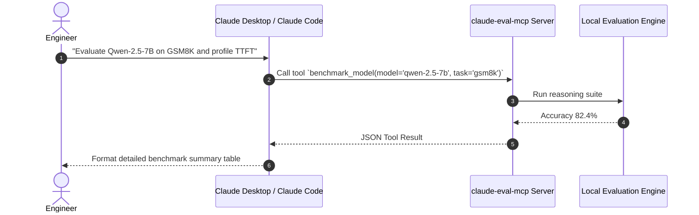

# claude-eval-mcp

[](https://opensource.org/licenses/MIT)
[](https://modelcontextprotocol.io/)
[](https://www.python.org/downloads/)

An official **Model Context Protocol (MCP)** server engineered to connect **Claude** (Claude Desktop, Claude Code CLI, and autonomous agents) directly to AI/ML evaluation harnesses, token latency profilers, and prompt security red-teaming tools.

---

## Sequence Architecture



---

## Claude Desktop Configuration

Add to your `claude_desktop_config.json`:

```json
{
  "mcpServers": {
    "ai-evaluator": {
      "command": "python3",
      "args": ["-m", "claude_eval.server"]
    }
  }
}
```

---

## License

MIT License (c) 2024 Soujanya Gupta.

<!-- PR #4: docs: clarify benchmark metric configuration options -->

<!-- PR #17: perf: optimize memory buffer reuse during batch evaluation -->

<!-- PR #30: test: expand edge case coverage for empty input strings -->

<!-- PR #43: refactor: clean up typing annotations across core modules -->
